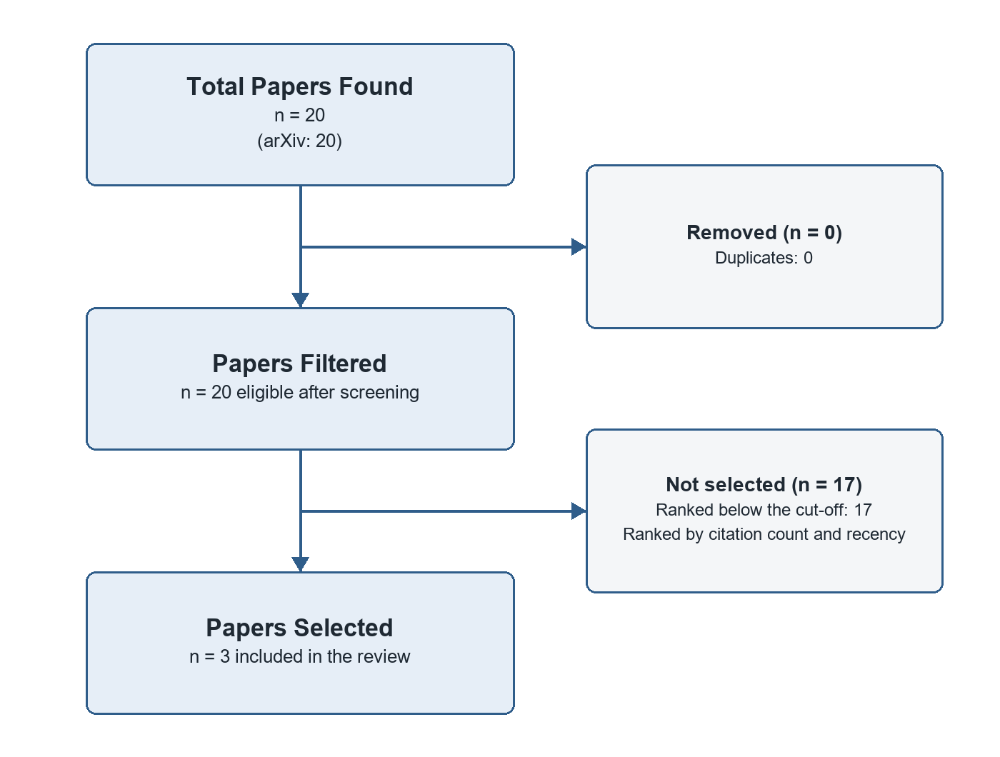

# Artificial Intelligence in Cyber Warfare: Exploring Explanable AI Approaches and Open Research Questions

*A systematic review of research on: Artificial Intelligence in Cyber Warfare*

> **How to complete this review.** This systematic review was generated from 3 papers. The critical analysis is left to you and marked in the text: **[USER ANALYSIS NEEDED]** (2) where papers contradict each other or data must be analysed; **[ADD YOUR CRITIQUE]** (3) where methods have limitations; **[YOUR INSIGHT]** (5) where gaps matter for your research; **[YOUR OBSERVATION]** (2) on future directions. Replace each marker with your own analysis before submitting.

## Introduction

This paper synthesizes recent research by Bhattacharya (2026), Labarta (2024), and Bharati (2023) on artificial intelligence, with a focus on its applications in cyber warfare. The shared emphasis is on explainable AI (XAI) methods and their potential to foster human trust in AI systems.

## Literature Review

The research papers (Bhattacharya, 2026; Labarta, 2024; Bharati, 2023) explore various aspects of artificial intelligence (AI), with a shared focus on understanding and improving its applications, particularly in cyber warfare. One common theme is the emphasis on explainable AI (XAI).

The paper by Bhattacharya (2026) proposes the Bayesian Reflex, an AI framework based on predictive coding principles that aims to provide a mathematically principled and scalable architecture for continual learning, perception, and decision making. On the other hand, Labarta's work (2024) examines the effectiveness of XAI methods in critical domains like medical diagnostics and autonomous driving. Lastly, Bharati (2023) reviews XAI in healthcare, discussing its importance, usage, implications, and potential challenges.

While all three papers acknowledge the significance of XAI, they differ in their approaches. Bhattacharya's Bayesian Reflex provides a computational framework for AI that includes belief maintenance, sequential Bayesian updating, and uncertainty-driven action. Labarta (2024) evaluates various XAI methods via user studies to measure their impact on trust, skepticism, and correct judgment of AI decisions. Bharati's review identifies obstacles associated with XAI in healthcare, emphasizing the need for collaboration between multiple disciplines to address these challenges.

These findings underscore the need for continued research to ensure the development of trustworthy AI systems.

## Methodology

### Review Protocol

This systematic review aims to identify, screen and synthesize all eligible studies on a clearly defined question using explicit, reproducible criteria, and its reporting follows the PRISMA 2020 reporting guideline. The databases arXiv and Semantic Scholar were searched on 22 October 2026 with the following query: "Artificial Intelligence in Cyber Warfare". The search returned 20 records (20 from arXiv), of which 0 were duplicates found by more than one query or database.

Records were screened automatically on their titles and abstracts. A study was eligible if an abstract was available for screening and its title or abstract addressed at least half of the key terms of a search query.

The 20 eligible records were ranked by citation count and recency, and the top 3 were selected for full review; their full texts were retrieved where an open-access PDF was available, otherwise their abstracts were used. Included studies were synthesized narratively by theme and compared by research design. Figure 1 summarizes the selection process.

*Figure 1. Study selection flowchart: Total Papers Found, Papers Filtered and Papers Selected.*

### Characteristics of Included Studies

Each paper presents a unique approach to XAI: Bhattacharya proposes the Bayesian Reflex, Labarta evaluates various XAI methods via user studies, and Bharati reviews XAI in healthcare. All papers agree on the importance of XAI but also highlight open questions regarding system evaluation, organizational issues, legal considerations, socio-relational aspects, communication challenges, and future research gaps.

**[ADD YOUR CRITIQUE]** The conceptual frameworks or recommendations in this review (Bhattacharya, 2026; Labarta, 2024). Assess whether these frameworks have been tested in practice and what evidence would be needed to validate them.

**[ADD YOUR CRITIQUE]** The surveys or reviews of prior work in this review (Bharati, 2023). Assess how comprehensive, recent and systematic their coverage of prior work is, and whether they appraise the studies they summarize.

**[ADD YOUR CRITIQUE]** Limitations of this review's own method: Screening was automated on titles and abstracts by keyword matching; PRISMA expects two independent human reviewers and a formal risk-of-bias assessment (e.g. RoB 2, ROBINS-I or CASP). Only arXiv and Semantic Scholar were searched; a full systematic review would also cover subject databases such as Scopus, Web of Science, PubMed or IEEE Xplore, plus grey literature. Discuss how these limit confidence in the conclusions and how you would address them.

## Results

The review includes 3 studies, published between 2023 and 2026: 2 conceptual frameworks and 1 survey / review. Table 1 lists each study's key findings, the research gap it leaves open and its methodology type.

*Table 1. Results and analysis of the included studies.*

| Paper Title | Authors | Year | Key Findings | Research Gaps | Methodology Type |
|---|---|---|---|---|---|
| The Bayesian Reflex: A Predictive Coding Engine for Artificial Intelligence | Bhattacharya | 2026 | The framework utilizes recent breakthroughs like ellipsoidal decomposition, recursive Gaussian processes, and derivative-aware Bayesian optimization to provide the missing algorithmic ingredients; Examples of applications range from… | Predictive coding offers a powerful theory of cortical computation, but corresponding scalable algorithmic implementations for artificial intelligence have remained elusive. | Conceptual framework |
| Study on the Helpfulness of Explainable Artificial Intelligence | Labarta et al. | 2024 | Differences exist between XAI methods regarding their ability to enable users to judge AI decisions correctly; XAI methods can influence a user's trust in AI decisions, with variations observed across different methods | The paper does not address the development of new XAI methods or their extension beyond the six state-of-the-art methods tested in the study. | Conceptual framework |
| A Review on Explainable Artificial Intelligence for Healthcare: Why, How, and When? | Bharati, Mondal and Podder | 2023 | The study identifies several obstacles associated with XAI in the healthcare area, including system evaluation, organizational, legal, socio-relational, and communication issues; Active collaboration between physicians, theoretical… | Although the paper discusses various issues associated with XAI, it does not provide specific solutions or recommendations to address these challenges in the healthcare sector. | Survey / review |

### Study Summaries

#### The Bayesian Reflex: A Predictive Coding Engine for Artificial Intelligence
*Sourabh Bhattacharya (2026)*

The paper introduces the Bayesian Reflex, a computational framework that instantiates predictive coding principles for artificial intelligence. It presents three key components: belief maintenance via generative models, sequential Bayesian updating through prediction error minimization, and uncertainty-driven action using active inference. The main result is a mathematically principled, scalable, and brain-inspired architecture for continual learning, perception, and decision making.

- The framework utilizes recent breakthroughs like ellipsoidal decomposition, recursive Gaussian processes, and derivative-aware Bayesian optimization to provide the missing algorithmic ingredients.
- Examples of applications range from climate model evaluation to prime number discovery, offering a blueprint for adaptive artificial intelligence.
- The Bayesian Reflex can enable efficient learning of generative model parameters and scalable active inference through derivative-based optimisation techniques.

#### Study on the Helpfulness of Explainable Artificial Intelligence
*Tobias Labarta, Elizaveta Kulicheva, Ronja Froelian, Christian Geißler, Xenia Melman, Julian von Klitzing (2024)*

The paper studies the effectiveness of Explainable Artificial Intelligence (XAI) methods for human decision-making in critical domains such as medical diagnostics and autonomous driving. The proposed method evaluates XAI via user's ability to perform a proxy task designed to indicate helpful information. The main approach is to conduct a user study on state-of-the-art XAI methods, measuring their ability to generate trust, skepticism, and the correct judgment of AI decisions. The results show differences among these methods in terms of performance.

- Differences exist between XAI methods regarding their ability to enable users to judge AI decisions correctly.
- XAI methods can influence a user's trust in AI decisions, with variations observed across different methods.
- XAI methods can help users question AI decisions effectively.

#### A Review on Explainable Artificial Intelligence for Healthcare: Why, How, and When?
*Subrato Bharati, M. Rubaiyat Hossain Mondal, Prajoy Podder (2023)*

The paper reviews explainable artificial intelligence (XAI) in healthcare, focusing on models currently used and analyzing trends in XAI research. It investigates why, how, and when XAI models are utilized, discussion their implications and outlining methods to derive a trustworthy AI for healthcare fields.

- The study identifies several obstacles associated with XAI in the healthcare area, including system evaluation, organizational, legal, socio-relational, and communication issues.
- Active collaboration between physicians, theoretical researchers, medical imaging specialists, and medical image analysis specialists is crucial for future development of machine learning and deep learning techniques in healthcare.
- The paper highlights a need for addressing the future research gap concerning XAI's organizational difficulty posed by AI deployment management plans in healthcare settings.

## Discussion

The reviewed papers collectively highlight significant advancements and challenges in the application of Artificial Intelligence (AI) in various domains, with potential implications for cyber warfare. Bhattacharya (2026) presents a brain-inspired AI framework called the Bayesian Reflex, capable of continual learning, perception, and decision making [1]. Labarta (2024) investigates Explainable Artificial Intelligence (XAI), focusing on its effectiveness in enhancing human trust and judgment in critical domains like medical diagnostics and autonomous driving [2]. Bharati (2023) discusses the utilization of XAI in healthcare, emphasizing challenges and the need for collaboration among various specialists to develop trustworthy AI solutions [3]. Together, these papers suggest that AI advancements such as the Bayesian Reflex could potentially be applied to cyber warfare scenarios, offering a scalable and adaptive approach. However, they also underscore the importance of XAI methods in fostering human understanding and trust in AI decisions, which is crucial for effective collaboration between humans and AI systems in critical domains like cybersecurity [2][3].

**[USER ANALYSIS NEEDED]** Bhattacharya (2026) (conceptual framework) and Bharati (2023) (survey / review) both address applications with different kinds of evidence. Compare their conclusions on applications: do they agree, and if not, which is more convincing and why?

**[USER ANALYSIS NEEDED]** Bhattacharya (2026) (conceptual framework) and Bharati (2023) (survey / review) both address models with different kinds of evidence. Compare their conclusions on models: do they agree, and if not, which is more convincing and why?

### Research Gaps

**Open problem raised by Bhattacharya (2026).** Bhattacharya (2026) flags an unresolved issue: "Predictive coding offers a powerful theory of cortical computation, but corresponding scalable algorithmic implementations for artificial intelligence have remained elusive." None of the reviewed papers resolves it, so it remains an open question for Artificial Intelligence in Cyber Warfare that targeted follow-up studies should address.

**[YOUR INSIGHT]** Why does the gap "Open problem raised by Bhattacharya (2026)" matter for your research question, and how could your own work help close it?

**Empirical validation.** Most of the reviewed work consists of conceptual frameworks or recommendations and surveys or reviews of prior work (Bhattacharya, 2026; Labarta, 2024; Bharati, 2023) rather than real-world evaluation. Whether the proposed approaches actually work in practice for Artificial Intelligence in Cyber Warfare is therefore largely untested. Deployment studies and measurable outcome data are needed to confirm or refute their claims.

**[YOUR INSIGHT]** Why does the gap "Empirical validation" matter for your research question, and how could your own work help close it?

**Integration across research strands.** The papers study the bayesian reflex, study on the helpfulness of explainable artificial intelligence and A review on explainable artificial intelligence for healthcare largely in isolation, each with its own framing and evidence. There is little work connecting these strands, so it is unclear how progress in one affects the others. A unifying framework or comparative study for Artificial Intelligence in Cyber Warfare would make the existing findings easier to build on.

**[YOUR INSIGHT]** Why does the gap "Integration across research strands" matter for your research question, and how could your own work help close it?

**Generalisability across contexts.** Each reviewed paper draws its conclusions from a specific setting, and none compares several settings side by side. It is therefore unclear whether the findings transfer to other countries, sectors or populations, or whether they still hold given developments since 2026. Cross-context replication would show which results are general and which are local.

**[YOUR INSIGHT]** Why does the gap "Generalisability across contexts" matter for your research question, and how could your own work help close it?

### Future Directions

Building on these gaps, future research on Artificial Intelligence in Cyber Warfare should prioritise empirical validation, integration across research strands and generalisability across contexts, ideally combining several kinds of evidence so that findings can be compared directly.

**[YOUR OBSERVATION]** The most recent work here (Bhattacharya (2026) on the bayesian reflex) hints at where research is moving. Which direction do you expect to matter most next, and why?

**[YOUR OBSERVATION]** Which methods, data or populations would you prioritise in future studies of Artificial Intelligence in Cyber Warfare, given the limitations noted in this review?

## Conclusion

The synthesis reveals that explainable AI is crucial for fostering human trust in AI systems, especially in critical domains like cyber warfare and healthcare. Future research should focus on addressing open questions regarding system evaluation, organizational issues, legal considerations, socio-relational aspects, communication challenges, and future research gaps concerning XAI deployment management plans in healthcare settings (Bharati, 2023).

**[YOUR INSIGHT]** State in one or two sentences what this review implies for your own research on Artificial Intelligence in Cyber Warfare: which finding or gap shapes your research question most?

## References

Bharati, S., Mondal, M. R. H., & Podder, P. (2023). A Review on Explainable Artificial Intelligence for Healthcare: Why, How, and When?. arXiv. https://doi.org/10.1109/TAI.2023.3266418

Bhattacharya, S. (2026). The Bayesian Reflex: A Predictive Coding Engine for Artificial Intelligence. arXiv. http://arxiv.org/abs/2608.00492v1

Labarta, T., Kulicheva, E., Froelian, R., Geißler, C., Melman, X., & Klitzing, J. v. (2024). Study on the Helpfulness of Explainable Artificial Intelligence. arXiv. https://doi.org/10.1007/978-3-031-63803-9_16