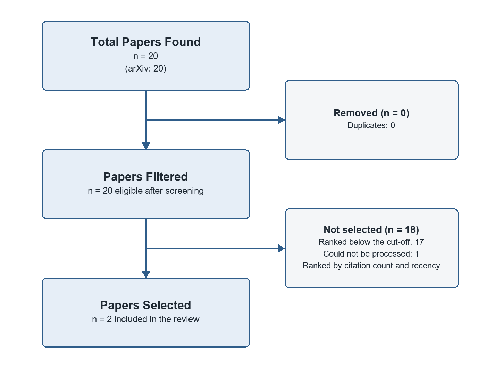

# Advancements in Machine Learning Methodologies: A Synthesis of Notton et al. (2026) and Cherednichenko et al. (2024)

*A narrative review of research on: Machine Learning*

## Introduction

This paper presents a synthesis of two recent studies by Notton et al. (2026) and Cherednichenko et al. (2024), both focusing on advancing machine learning methodologies. Notton et al.'s work introduces MerLin, a discovery engine for photonic and hybrid quantum ML, while Cherednichenko et al. integrate Shannon entropy and rough set theory to evaluate ML models.

## Literature Review

Both papers [Notton, 2026] and [Cherednichenko, 2024] delve into advancing machine learning (ML) methodologies, each from a unique perspective.

The papers differ in their objectives and methodologies.

Despite their differences, both papers agree on the need for advancements in ML methodologies. The Notton et al.'s work highlights MerLin's potential for practitioners to leverage existing tooling for ablation studies, cross-modality comparisons, and hybrid classical-quantum workflows (Notton, 2026), mirroring Cherednichenko et al.'s goal of enhancing the evaluation landscape of machine learning by offering a more nuanced perspective (Cherednichenko, 2024). However, the papers leave open avenues for further research. While MerLin already implements hardware-aware features and embeds photonic quantum models within established ML ecosystems, it remains to be seen how these advancements will impact the broader QML landscape (Notton, 2026). Similarly, the long-term implications of integrating Shannon entropy and rough set theory for various ML applications are yet to be fully explored in future studies (Cherednichenko, 2024).

## Methodology

### Review Protocol

This narrative review aims to summarize and interpret the main lines of research on a topic, and its reporting follows no formal reporting guideline (the SANRA scale can be used to assess its quality). The databases arXiv and Semantic Scholar were searched on 22 October 2026 with the following query: "Machine Learning". The search returned 20 records (20 from arXiv), of which 0 were duplicates found by more than one query or database.

No formal eligibility criteria were applied beyond relevance to the search queries.

The 20 eligible records were ranked by citation count and recency, and the top 3 were selected for full review; their full texts were retrieved where an open-access PDF was available, otherwise their abstracts were used. 1 selected record(s) could not be processed and were dropped. Included studies were discussed thematically, highlighting agreements, differences and open questions. Figure 1 summarizes the selection process.

*Figure 1. Study selection flowchart: Total Papers Found, Papers Filtered and Papers Selected.*

### Characteristics of Included Studies

Notton et al.'s MerLin targets the systematic exploration of QML models, datasets, and hardware constraints. Cherednichenko et al. aim to generalize ML evaluation by integration Shannon entropy and rough set theory.

**[MANUAL REVIEW NEEDED]** (ADD YOUR CRITIQUE) The empirical studies in this review (Notton, 2026; Cherednichenko, 2024). Assess their samples, datasets and measures: are they large and representative enough, and do the settings studied support the conclusions drawn?

**[MANUAL REVIEW NEEDED]** (ADD YOUR CRITIQUE) Limitations of this review's own method: Papers were selected by relevance ranking and citation count rather than predefined eligibility criteria, which makes the selection open to bias toward highly cited work. Discuss how these limit confidence in the conclusions and how you would address them.

## Results

The review includes 2 studies, published between 2024 and 2026: 2 empirical studys. Table 1 lists each study's key findings, the research gap it leaves open and its methodology type.

*Table 1. Results and analysis of the included studies.*

| Paper Title | Authors | Year | Key Findings | Research Gaps | Methodology Type |
|---|---|---|---|---|---|
| MerLin: A Discovery Engine for Photonic and Hybrid Quantum Machine Learning | Notton et al. | 2026 | MerLin allows practitioners to leverage existing tooling for ablation studies, cross-modality comparisons, and hybrid classical-quantum workflows; The framework already implements hardware-aware features, allowing tests on available… | The paper does not address the scalability limitations of near-term QML hardware in terms of qubit count or connectivity that could impact the applicability and generalization of photonic QML models trained using MerLin. | Empirical study |
| Generalizing Machine Learning Evaluation through the Integration of Shannon Entropy and Rough Set Theory | Cherednichenko et al. | 2024 | The integration of entropy's measure of uncertainty with the granular perspective of rough set theory illuminates aspects of model behavior and data structure that are typically obscured in conventional evaluations; The approach is tested… | While the paper demonstrates the efficacy of its approach on various datasets, it does not provide an empirical comparison between the proposed method and existing methods in terms of predictive performance or interpretability, leaving… | Empirical study |

### Study Summaries

#### MerLin: A Discovery Engine for Photonic and Hybrid Quantum Machine Learning
*Cassandre Notton, Benjamin Stott, Philippe Schoeb, Anthony Walsh, Grégoire Leboucher, Vincent Espitalier, Vassilis Apostolou, Louis-Félix Vigneux, Alexia Salavrakos, Jean Senellart (2026)*

The paper introduces MerLin, a discovery engine for photonic and hybrid quantum machine learning (QML) that aims to systematically explore QML models, datasets, and hardware constraints beyond isolated algorithmic proposals. MerLin integrates optimized strong simulation of linear optical circuits into standard PyTorch and scikit-learn workflows, enabling end-to-end differentiable training of quantum layers. As an initial contribution, the paper reproduces eighteen state-of-the-art photonic and hybrid QML works, releasing reusable, modular experiments that establish a shared experimental baseline for empirical benchmarking.

- The framework already implements hardware-aware features, allowing tests on available quantum hardware while enabling exploration beyond its current capabilities.
- By embedding photonic quantum models within established machine learning ecosystems, MerLin positions itself as a forward-looking co-design tool linking algorithms, benchmarks, and hardware.

#### Generalizing Machine Learning Evaluation through the Integration of Shannon Entropy and Rough Set Theory
*Olga Cherednichenko, Dmytro Chernyshov, Dmytro Sytnikov, Polina Sytnikova (2024)*

The research paper presents a novel approach to generalize machine learning evaluation by integration Shannon entropy and rough set theory. The method aims to provide a more nuanced and comprehensive evaluation of machine learning models by considering both their predictive performance and data structure complexity.

- The integration of entropy's measure of uncertainty with the granular perspective of rough set theory illuminates aspects of model behavior and data structure that are typically obscured in conventional evaluations.
- The approach is tested on various datasets, demonstrating its capability to assess predictive performance as well as underlying data complexity and model robustness.
- The results underscore the utility of this integrated approach in enhancing the evaluation landscape of machine learning, offering a multi-faceted perspective that balances accuracy with a profound understanding of data attributes and model dynamics.

## Discussion

The presented literature (Notton, 2026; Cherednichenko, 2024) offers significant insights into the advancements and diversification of machine learning. Notton (2026) introduces MerLin, a discovery engine for photonic and hybrid quantum machine learning, enabling end-to-end differentiable training of quantum layers, while Cherednichenko (2024) proposes an integrated approach to evaluate machine learning models using Shannon entropy and rough set theory. Together, these works underscore the ongoing expansion of machine learning beyond classical computing, with MerLin positioning itself as a co-design tool for algorithms, benchmarks, and hardware in quantum machine learning (Notton, 2026), while Cherednichenko's approach emphasizes the importance of considering both predictive performance and data structure complexity during evaluation (Cherednichenko, 2024). This synergy highlights the need for a comprehensive, multi-faceted perspective in advancing machine learning research.

**[MANUAL REVIEW NEEDED]** (USER ANALYSIS NEEDED) Compare the earliest study, Cherednichenko (2024), with the most recent, Notton (2026): do the newer findings confirm, refine or contradict the earlier ones?

### Research Gaps

**Long-term evidence.** The empirical studies reviewed capture Machine Learning at a single point in time. How their findings hold up as technology, institutions and practices change is unknown, which calls for longitudinal studies that track outcomes over several years.

**[MANUAL REVIEW NEEDED]** (YOUR INSIGHT) Why does the gap "Long-term evidence" matter for your research question, and how could your own work help close it?

**Integration across research strands.** The papers study A discovery engine for photonic and hybrid quantum machine learning and generalizing machine learning evaluation through the integration of shannon entropy and rough set theory largely in isolation, each with its own framing and evidence. There is little work connecting these strands, so it is unclear how progress in one affects the others. A unifying framework or comparative study for Machine Learning would make the existing findings easier to build on.

**[MANUAL REVIEW NEEDED]** (YOUR INSIGHT) Why does the gap "Integration across research strands" matter for your research question, and how could your own work help close it?

**Generalisability across contexts.** Each reviewed paper draws its conclusions from a specific setting, and none compares several settings side by side. It is therefore unclear whether the findings transfer to other countries, sectors or populations, or whether they still hold given developments since 2026. Cross-context replication would show which results are general and which are local.

**[MANUAL REVIEW NEEDED]** (YOUR INSIGHT) Why does the gap "Generalisability across contexts" matter for your research question, and how could your own work help close it?

### Future Directions

Building on these gaps, future research on Machine Learning should prioritise long-term evidence, integration across research strands and generalisability across contexts, ideally combining several kinds of evidence so that findings can be compared directly.

**[MANUAL REVIEW NEEDED]** (YOUR OBSERVATION) The most recent work here (Notton (2026) on A discovery engine for photonic and hybrid quantum machine learning) hints at where research is moving. Which direction do you expect to matter most next, and why?

**[MANUAL REVIEW NEEDED]** (YOUR OBSERVATION) Which methods, data or populations would you prioritise in future studies of Machine Learning, given the limitations noted in this review?

## Conclusion

The reviewed papers collectively demonstrate advancements in machine learning, with [Notton, 2026] introducing MerLin, a tool that bridges the gap between quantum computing and traditional machine learning, enabling end-to-end differentiable training of quantum layers. Simultaneously, [Cherednichenko, 2024] presents an integrated approach using Shannon entropy and rough set theory to evaluate machine learning models more comprehensively, considering both predictive performance and data structure complexity. These developments collectively underscore the importance of expanding machine learning's horizons by leveraging quantum computing capabilities and enhancing evaluation methodologies for a more nuanced understanding of model behavior and data attributes.

**[MANUAL REVIEW NEEDED]** (YOUR INSIGHT) State in one or two sentences what this review implies for your own research on Machine Learning: which finding or gap shapes your research question most?

## References

Cherednichenko, O., Chernyshov, D., Sytnikov, D., & Sytnikova, P. (2024). Generalizing Machine Learning Evaluation through the Integration of Shannon Entropy and Rough Set Theory. arXiv. http://arxiv.org/abs/2404.12511v1

Notton, C., Stott, B., Schoeb, P., Walsh, A., Leboucher, G., Espitalier, V., Apostolou, V., Vigneux, L., Salavrakos, A., & Senellart, J. (2026). MerLin: A Discovery Engine for Photonic and Hybrid Quantum Machine Learning. arXiv. http://arxiv.org/abs/2602.11092v2
