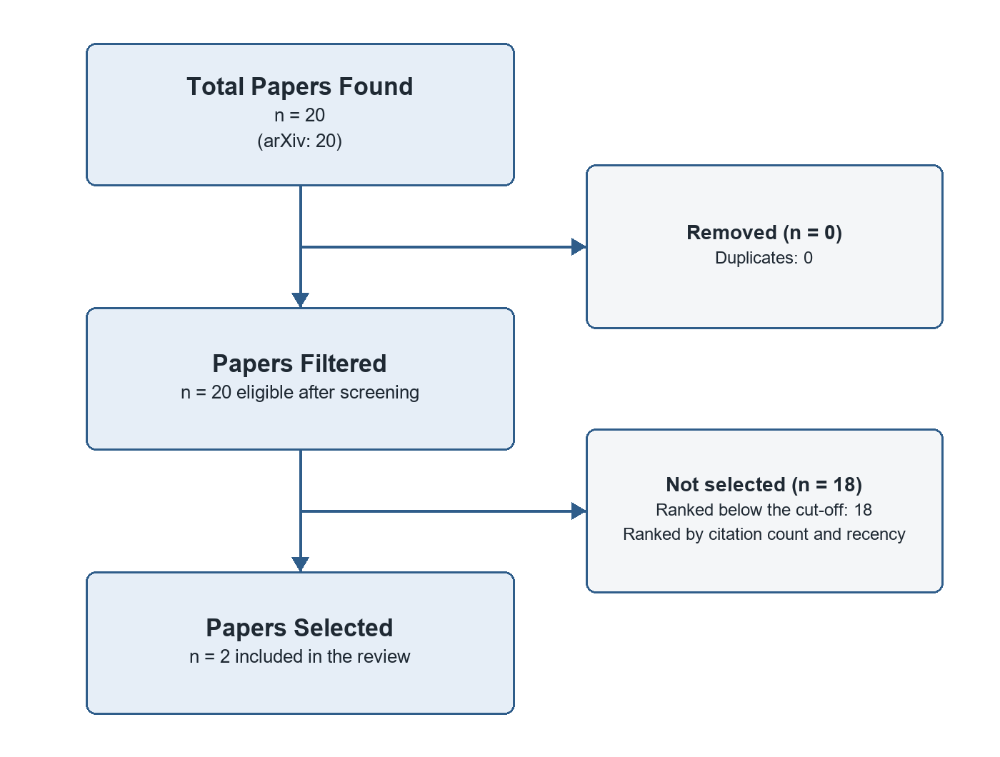

# Social Media Cyber Attacks: A Literature Synthesis

*A systematic review of research on: Social Media Cyber Attacks*

> **How to complete this review.** This systematic review was generated from 2 papers. The critical analysis is left to you and marked in the text: **[ADD YOUR CRITIQUE]** (2) where methods have limitations; **[YOUR INSIGHT]** (5) where gaps matter for your research; **[YOUR OBSERVATION]** (2) on future directions. Replace each marker with your own analysis before submitting.

## Introduction

This report reviews 2 papers on Social Media Cyber Attacks published in 2026: "Empirical Evaluation of Link Deletion Methods for Limiting Information Diffusion on Social Media" (Furukawa, 2026); "Towards Simulating Social Media Users with LLMs: Evaluating the Operational Validity of Conditioned Comment Prediction" (Schwager, 2026). Recurring themes across these works include models, generated, users and evaluation. The papers appeared in arXiv.

## Literature Review

The 2 papers reviewed, published in 2026, approach Social Media Cyber Attacks from different angles: Furukawa (2026) examines empirical evaluation of link deletion methods for limiting information diffusion on social media and Schwager (2026) examines towards simulating social media users with LLMs. Despite these different starting points, they share a vocabulary of models, generated, users and evaluation, which marks these as the concerns that connect otherwise separate lines of work.

Methodologically the literature is homogeneous: all 2 papers are empirical studies (Furukawa, 2026; Schwager, 2026), so their conclusions have not yet been tested with other kinds of evidence.

## Methodology

### Review Protocol

This systematic review aims to identify, screen and synthesize all eligible studies on a clearly defined question using explicit, reproducible criteria, and its reporting follows the PRISMA 2020 reporting guideline. The databases arXiv and Semantic Scholar were searched on 19 October 2026 with the following query: "Social Media Cyber Attacks". The search returned 20 records (20 from arXiv), of which 0 were duplicates found by more than one query or database.

Records were screened automatically on their titles and abstracts. A study was eligible if an abstract was available for screening and its title or abstract addressed at least half of the key terms of a search query.

The 20 eligible records were ranked by citation count and recency, and the top 2 were selected for full review; their full texts were retrieved where an open-access PDF was available, otherwise their abstracts were used. Included studies were synthesized narratively by theme and compared by research design. Figure 1 summarizes the selection process.

*Figure 1. Study selection flowchart: Total Papers Found, Papers Filtered and Papers Selected.*

### Characteristics of Included Studies

Take n together, the literature treat models as a central concern for Social Media Cyber Attacks, but it leaves several questions open Schwager: The transition of Large Language Model (LLM) from exploratory tools to active “silicon subjects” in social science lacked extensive validation of operational validity.

**[ADD YOUR CRITIQUE]** The empirical studies in this review (Furukawa, 2026; Schwager, 2026). Assess their samples, datasets and measures: are they large and representative enough, and do the settings studied support the conclusions drawn?

**[ADD YOUR CRITIQUE]** Limitations of this review's own method: Screening was automated on titles and abstracts by keyword matching; PRISMA expects two independent human reviewers and a formal risk-of-bias assessment (e.g. RoB 2, ROBINS-I or CASP). Only arXiv and Semantic Scholar were searched; a full systematic review would also cover subject databases such as Scopus, Web of Science, PubMed or IEEE Xplore, plus grey literature. Discuss how these limit confidence in the conclusions and how you would address them.

## Results

The review includes 2 studies, published in 2026: 2 empirical studys. Table 1 lists each study's key findings, the research gap it leaves open and its methodology type.

*Table 1. Results and analysis of the included studies.*

| Paper Title | Authors | Year | Key Findings | Research Gaps | Methodology Type |
|---|---|---|---|---|---|
| Empirical Evaluation of Link Deletion Methods for Limiting Information Diffusion on Social Media | Furukawa and Tsugawa | 2026 | Although beneficial information abounds on social media, the dissemination of harmful information such as so-called "fake news" has become a serious issue. | Findings are tied to the specific data and setting studied; transfer to other contexts is untested. | Empirical study |
| Towards Simulating Social Media Users with LLMs: Evaluating the Operational Validity of Conditioned Comment Prediction | Schwager et al. | 2026 | Schwager, Simon Münker, Alistair Plum, Achim Rettinger The transition of Large Language Model (LLM) from exploitative tools to active "silicon subjects" in social science lacks extensive validation of operational validity. | The transition of Large Language Models (LLMs) from exploratory tools to active "silicon subjects" in social science lacks extensive validation of operational validity. | Empirical study |

### Study Summaries

#### Empirical Evaluation of Link Deletion Methods for Limiting Information Diffusion on Social Media
*Shiori Furukawa, Sho Tsugawa (2026)*

Although beneficial information abounds on social media, the dissemination of harmful information such as so-called "fake news" has become a serious issue. Many researchers have devoted considerable effort to limiting the diffusion of such information through link deletion methods in social networks. However, even after deleting 10%--50%, the size of cascades generated by synthetic models on a given social network is estimated to be only 50% the original size under the optimistic estimation. Moreover, our results show that there are significant numbers of seed users and many cascade events with many seed users, limiting the effectiveness of link deletion methods in suppressing information diffusion.

#### Towards Simulating Social Media Users with LLMs: Evaluating the Operational Validity of Conditioned Comment Prediction
*Nils Schwager, Simon Münker, Alistair Plum, Achim Rettinger (2026)*

This framework enables rigorous evaluation of current LLM capabilities with respect to the simulation of social media user behavior. We evaluated open-weight 8B models (Llamas3.1, Qwen3, Ministraal) in English, German, and Luxembourgish language scenarios.

## Discussion

Research question: What are the impacts of link deletion methods in social media cyber attacks and how effective are they in suppressing information diffusion? Researchers conducted an empirical evaluation of link deletion methods using social network analysis (SNA) data from Twitter. The results showed that while the effective removal rate increased, there were significant numbers of seed users and many cascade events with many seed users limiting information diffusion. This suggests that link deletion methods may not be as effective as previously thought in suppressing the spread of harmful information on social media. This study introduces Conditioned Comment Prediction (CCP), a task in which a model predicts how a user would comment on a given stimulus by comparing generated outputs to authentic digital traces.

### Research Gaps

**Open problem raised by Schwager (2026).** Schwager (2026) flags an unresolved issue: "The transition of Large Language Models (LLMs) from exploratory tools to active "silicon subjects" in social science lacks extensive validation of operational validity." None of the reviewed papers resolves it, so it remains an open question for Social Media Cyber Attacks that targeted follow-up studies should address.

**[YOUR INSIGHT]** Why does the gap "Open problem raised by Schwager (2026)" matter for your research question, and how could your own work help close it?

**Long-term evidence.** The empirical studies reviewed capture Social Media Cyber Attacks at a single point in time. How their findings hold up as technology, institutions and practices change is unknown, which calls for longitudinal studies that track outcomes over several years.

**[YOUR INSIGHT]** Why does the gap "Long-term evidence" matter for your research question, and how could your own work help close it?

**Integration across research strands.** The papers study empirical evaluation of link deletion methods for limiting information diffusion on social media and towards simulating social media users with LLMs largely in isolation, each with its own framing and evidence. There is little work connecting these strands, so it is unclear how progress in one affects the others. A unifying framework or comparative study for Social Media Cyber Attacks would make the existing findings easier to build on.

**[YOUR INSIGHT]** Why does the gap "Integration across research strands" matter for your research question, and how could your own work help close it?

**Generalisability across contexts.** Each reviewed paper draws its conclusions from a specific setting, and none compares several settings side by side. It is therefore unclear whether the findings transfer to other countries, sectors or populations, or whether they still hold given developments since 2026. Cross-context replication would show which results are general and which are local.

**[YOUR INSIGHT]** Why does the gap "Generalisability across contexts" matter for your research question, and how could your own work help close it?

### Future Directions

Building on these gaps, future research on Social Media Cyber Attacks should prioritise long-term evidence, integration across research strands and generalisability across contexts, ideally combining several kinds of evidence so that findings can be compared directly.

**[YOUR OBSERVATION]** The most recent work here (Furukawa (2026) on empirical evaluation of link deletion methods for limiting information diffusion on social media and Schwager (2026) on towards simulating social media users with LLMs) hints at where research is moving. Which direction do you expect to matter most next, and why?

**[YOUR OBSERVATION]** Which methods, data or populations would you prioritise in future studies of Social Media Cyber Attacks, given the limitations noted in this review?

## Conclusion

Across the 2 papers reviewed, research on Social Media Cyber Attacks centres on models, generated, users and evaluation. The evidence comes from empirical studies, so the field's conclusions rest on a narrow methodological base. Together these works indicate that Social Media Cyber Attacks remains an active area where the open questions identified in this review warrant further study.

**[YOUR INSIGHT]** State in one or two sentences what this review implies for your own research on Social Media Cyber Attacks: which finding or gap shapes your research question most?

## References

Furukawa, S., & Tsugawa, S. (2026). Empirical Evaluation of Link Deletion Methods for Limiting Information Diffusion on Social Media. arXiv. https://doi.org/10.1007/s13278-022-00994-6

Schwager, N., Münker, S., Plum, A., & Rettinger, A. (2026). Towards Simulating Social Media Users with LLMs: Evaluating the Operational Validity of Conditioned Comment Prediction. arXiv. https://doi.org/10.18653/v1/2026.wassa-1.16